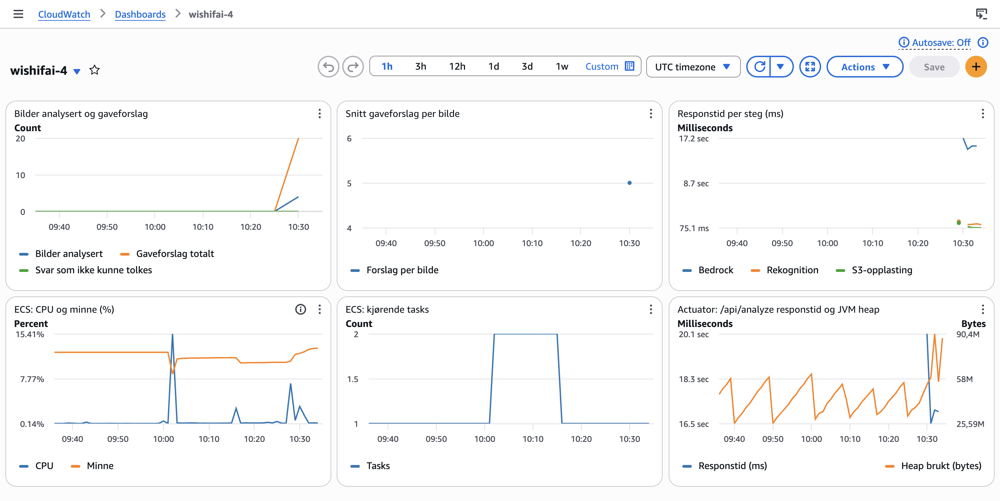

# PGR301 Eksamen 2026 - Besvarelse Kandidatnummer 4

## Oppgave 1

Bygg imaget fra repo-root:

```
docker build -t wishifai .
```

Kopier `.env.example` til `.env`, og fyll inn egne verdier for `AWS_ACCESS_KEY_ID` og `AWS_SECRET_ACCESS_KEY`:

```
cp .env.example .env
```

Start en container på localhost:9999:

```
docker run --rm -p 9999:8080 --env-file .env -e S3_BUCKET=wishifai-4-images wishifai
```

Test fra en annen terminal:

```
curl -F "image=@samples/sample_image.png" http://localhost:9999/api/analyze
```

Imaget tagges med både commit-SHA (`github.sha`) og `latest`. SHA-taggen gjør det mulig å spore nøyaktig hvilken commit som kjører hvor, og å rulle tilbake. Terraform deployer alltid SHA-taggen, ikke `latest`.

Grønn kjøring: https://github.com/LeanderChristensen/pgr301-exam-2026/actions/runs/41878986512

## Oppgave 2

Public service URL: https://wi-15835376c25847ba8ee36012093e0c1d.ecs.eu-west-1.on.aws

Terraform-state lagres i den delte S3-bucketen `pgr301-terraform-state` med nøkkelen `wishifai/4/terraform.tfstate`. Task-rollen følger minste privilegium, og gir bare tilgang til det applikasjonen faktisk
bruker. Kandidatnummeret i nøkkelen gjør at state-filen ikke kolliderer med andre kandidater. Terraform må kjøre etter container-build fordi den deployer image-taggen som bygges i forrige jobb. Med `needs:` deployes heller ingenting hvis bygget feiler, så tjenesten fortsetter å kjøre den forrige fungerende versjonen.

Grønn kjøring: https://github.com/LeanderChristensen/pgr301-exam-2026/actions/runs/42223855036

## Oppgave 3

`rekognition.duration`, `bedrock.duration`, `s3.upload.duration` (Timer): måler hvert av de tre stegene i en analyse hver for seg, slik at jeg kan se hvor tiden blir av når tjenesten er treg.

`gift.suggestions` (DistributionSummary), business-metrikk: viser hvor mange bilder som analyseres (count), hvor mange gaveforslag som genereres totalt (sum), og snitt per bilde (avg). Det sier noe om faktisk bruk, og om modellen leverer det brukeren forventer (inntil 5 forslag).

Dashboard: `wishifai-4` i eu-west-1 (screenshot: `media/dashboard.png`)

- Business: antall bilder analysert, antall gaveforslag og snitt forslag per bilde.
- Applikasjon: responstid per steg (Bedrock, Rekognition, S3) fra mine egne timere, og responstid for `/api/analyze` og JVM heap fra Spring Boot Actuator.
- Infrastruktur: CPU, minne og antall kjørende tasks fra ECS.

Alarmen `wishifai-4-bedrock-slow` går når Bedrock i snitt bruker over 20 sekunder per kall i to perioder på fem minutter på rad. Bedrock er det tregeste steget, og treghet er det grunderen er bekymret for. To perioder på rad unngår falske alarmer fra enkeltstående trege kall.

